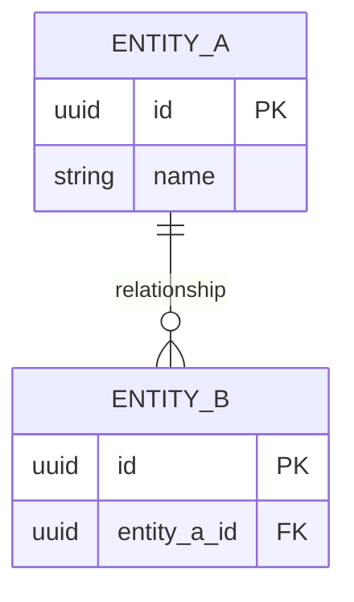

# Data Model

<!--
  The entities the system stores, their fields/types, and how they relate. Second
  document of the modeling phase (Step 3b). Depends on the SRS and use cases.
  This is the design-time data model; the implemented schema is mirrored in
  architecture.md → Data Model. Local summary; link the source at the top.
  See workflows/project-kickoff.md → Step 3b for the interview questions.
-->

> **Primary source:** {{LINK to authoritative copy}}
>
> Always consult the source for the authoritative version. This file is a quick-reference summary.

**Project:** {{PROJECT_NAME}}
**Version:** {{0.1 — Draft}}
**Date:** {{YYYY-MM-DD}}
**Status:** {{Draft / Under review}}

**Paradigm:** {{relational / document / graph / key-value}}

---

## Entities

<!-- One table per entity. -->

### {{Entity}}

| Field | Type | Constraints | Description |
|---|---|---|---|
| id | {{uuid / int}} | PK | {{identifier}} |
| {{field}} | {{type}} | {{required / unique / default}} | {{what it holds}} |

**Relationships:** {{e.g. has many {{Other}}; belongs to {{Parent}}}}

---

## Entity-Relationship Diagram



---

## Class Diagram (if object-oriented)

```mermaid
classDiagram
  class {{ClassName}} {
    +{{type}} {{field}}
    +{{returnType}} {{method}}()
  }
```

---

## Enumerations & Shared Types

| Type | Values / shape | Used by |
|---|---|---|
| {{Status}} | {{active / archived}} | {{entities}} |

---

## Data Rules

- {{retention / soft-delete / audit / derived fields / uniqueness rules}}

---

## Open Questions

| # | Question | Owner | Status |
|---|---|---|---|
| 1 | {{unresolved data question}} | {{who}} | Open |
