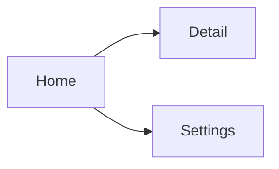

# Wireframes

<!--
  Low-fidelity layout of each screen, for every device the software runs on.
  Third document of the modeling phase (Step 3c). Depends on the use cases.
  Keep these LOW fidelity — structure and flow, not final visuals (that's the
  design doc). Local summary; link the source / design-tool file at the top.
  See workflows/project-kickoff.md → Step 3c for the interview questions.
-->

> **Primary source:** {{LINK to Figma / Excalidraw / image assets}}
>
> Always consult the source for the authoritative version. This file is a quick-reference summary.

**Project:** {{PROJECT_NAME}}
**Version:** {{0.1 — Draft}}
**Date:** {{YYYY-MM-DD}}
**Status:** {{Draft / Under review}}

---

## Target Devices

| Device / form factor | Supported | Notes |
|---|---|---|
| {{Web — desktop}} | {{yes/no}} | {{breakpoints, min width}} |
| {{Web — mobile}} | {{yes/no}} | {{}} |
| {{Native iOS / Android}} | {{yes/no}} | {{}} |
| {{Tablet}} | {{yes/no}} | {{}} |

---

## Screen Inventory

| Screen | Route / entry | Devices | Related UC | Purpose |
|---|---|---|---|---|
| {{Home}} | {{/}} | {{all}} | {{UC-0X}} | {{what it's for}} |

---

## Wireframes

<!-- One subsection per screen. Use an ASCII/box sketch inline, or link the asset.
     Note per-device differences where layouts diverge. -->

### {{Screen}} — `{{route}}`

**Purpose:** {{what the user does here}}
**Primary action:** {{the main thing}}

```
+--------------------------------------------------+
|  {{header / nav}}                                |
+--------------------------------------------------+
|                                                  |
|   {{key element}}          {{key element}}       |
|                                                  |
|   [ {{primary action button}} ]                  |
+--------------------------------------------------+
```

**Elements:** {{list the components on the screen}}
**Per-device notes:** {{how the layout adapts on mobile / tablet / etc.}}

---

## Navigation Model

{{How screens connect — tabs / stack / drawer / wizard. A small map helps:}}



---

## Open Questions

| # | Question | Owner | Status |
|---|---|---|---|
| 1 | {{unresolved layout question}} | {{who}} | Open |
